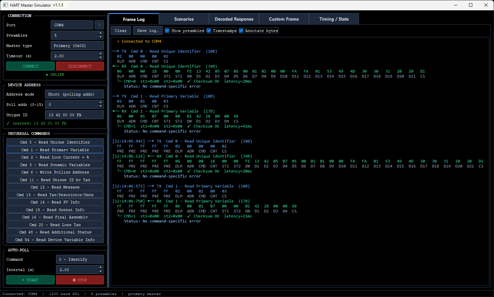
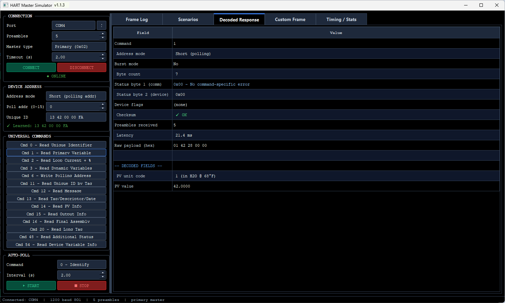
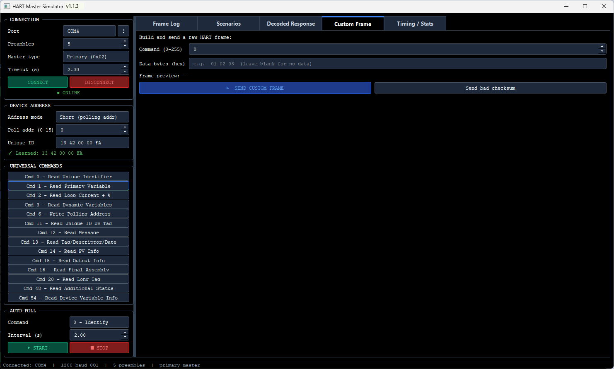
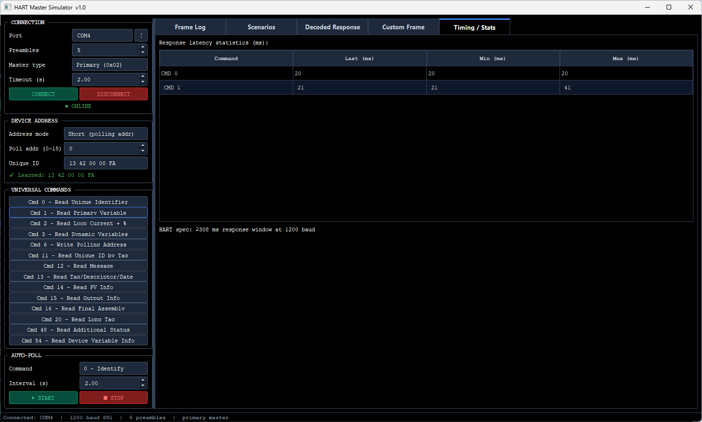
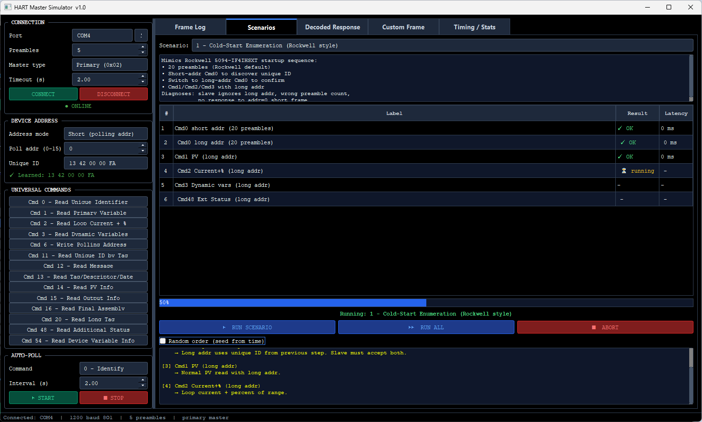
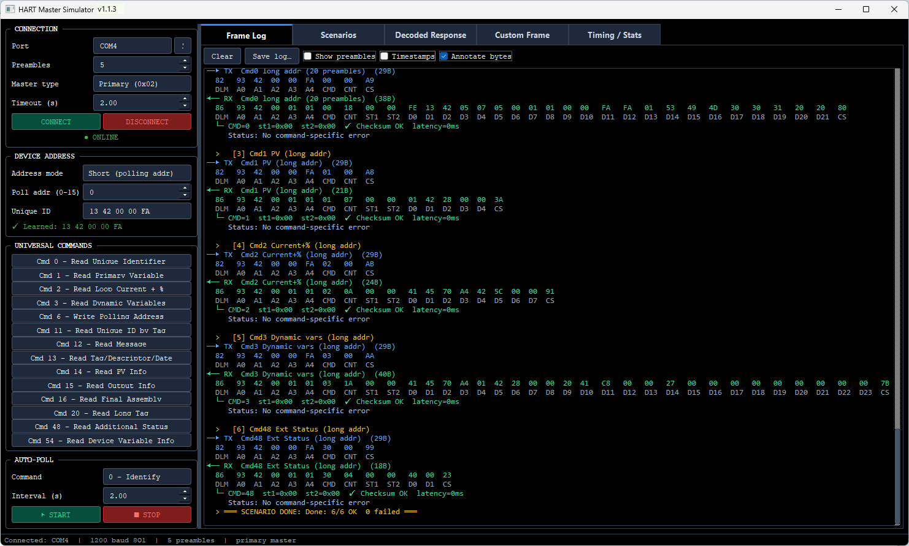

# HART Master Simulator

Diagnostic and simulation tool for testing HART slave devices and monitoring protocol exchange. Simulates master controller behaviors to validate field device conformity and physical layer compatibility.

## Features

- **Diagnostic Scenarios**: Pre-configured sequences ranging from standard cold-start enumeration to stress testing and invalid command injection.
- **Scenarios tab**: scenario list with a checkbox per row (Check All / Clear All); RUN SELECTED runs the ticked scenarios, RUN ALL runs every automatic one. Each run shows an overall PASS/FAIL plus a result per scenario. The ticked set is remembered in `hart_master_simulator_settings.json` next to the script.
- **Checked results**: steps can require response codes, Device Status bits, response data (also compared with earlier responses) and Config Change Counter deltas; per-master (primary/secondary) checks of Configuration Changed, Cold Start and Cmd38.
- **Universal Command Conformance** (scenario 17, UAL 3.1-3.17): content checks via `reject_rc`, run-time `expect_rc`, `check` callables; original values saved and restored.
- **Power-cycle scenarios** (15, 18, 19, manual): Cold Start per master (15) and NV persistence of the configuration (18) and polling address (19). The operator power-cycles the device (CyclePower). Cmd42 is not used: the HART test specifications (HCF_TEST-003 rev 5.1, HCF_TEST-004 rev 7.0) replaced every Device Reset with CyclePower. Cold Start proves the restart; original values are restored. RUN ALL skips these scenarios; tick them and use RUN SELECTED.
- **Common Practice commands**: "Common Practice" tab with every command of HCF_SPEC-151 sections 7.1-7.72 that the spec folder covers (Cmd33-59, 108, 109): request data entered as text, responses decoded (`hart_cp.py`). Scenario 20 checks the BUOS implementation (Cmd33/41/44/48/49/50/54/59; Cmd34-37, 40, 43, 45-47, 51, 108, 109 must answer RC 64) and restores the transducer serial number and preamble count.
- **Configurable Physical Layer Parameters**: Supports adjustable preamble counts, parity selection (`8O1`), and exact 1200 baud timing.
- **Dual-Master Simulation**: Toggle between primary master (`0x02`) and secondary master (`0x01`) roles.
- **Robust Address Validation**: Supports both short (polling address 0) and long (unique-ID) addressing schemes.
- **Custom UI Skinning**: Integrated QSS styling for dark-mode workspace execution.

## File Structure

- `hart_master_simulator.py`: Main PyQt5 application, serial interface worker thread, and GUI logic.
- `scenarios.py`: Dictionary definitions containing step-by-step diagnostic test routines (step keys documented at the top of the file and in `ScenarioRunner`).
- `hart_codec.py`: HART Packed ASCII / Date / Latin-1 encoding shared by the GUI and the scenarios.
- `hart_cp.py`: Common Practice command table, request encoders and response decoders (Cmd33-59, 108, 109).
- `tests/`: offline tests (no serial port): `fake_slave.py` models the HART 7 device, `test_simulator.py` runs every scenario against it and against fault-injected variants, `test_gui_smoke.py` runs scenarios through the GUI off-screen. Run with `python -m pytest -q tests`.
- `style.qss`: StyleSheet providing unified dark theme across interface components.

## Requirements

```bash
pip install PyQt5 pyserial

```

## Usage

```bash
python hart_master_simulator.py

```

1. Select active COM port.
2. Connect.
3. Run Indiviual comands or Scenarious.
4. Analyze output and status.


## Screenshots

<b>Hart Master Simulator - Frame Log:</b>


<b>Hart Master Simulator - Decoded Response:</b>


<b>Hart Master Simulator - Custom Frame:</b>


<b>Hart Master Simulator - Timing Stats:</b>


<b>Hart Master Simulator - Scenarios:</b>


<b>Hart Master Simulator - Scenarios in Frame Log:</b>
